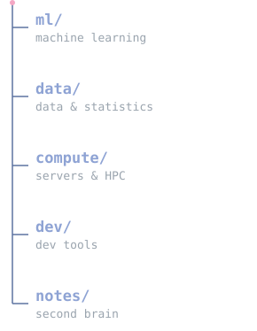
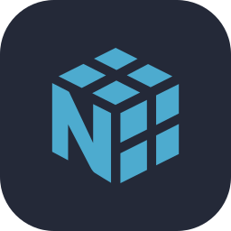
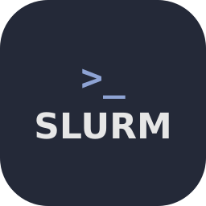
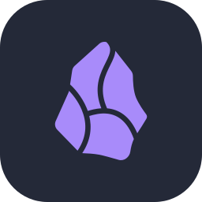
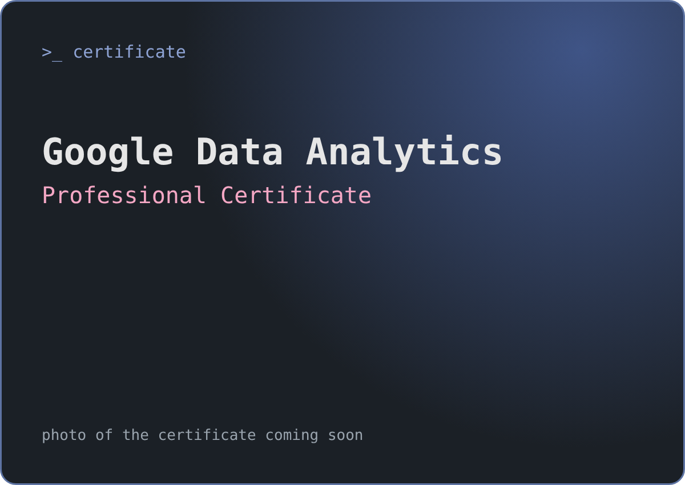

  

  

  
  

---

### Who am I

Hi! I'm **Kami**, a systems engineer turned data scientist, based in Brussels. I did the Specialized Master in **Data Science & Big Data** at the Université Libre de Bruxelles and I like models that are useful *and* understandable.

- 🔭 **Recently:** master's thesis on **federated causal discovery**, learning causal graphs (DAGs) across clients without sharing their data, with [Flower](https://flower.ai) and experiments on an HPC cluster (SLURM + GPUs).
- 🌍 **What drives me:** applying ML to socially meaningful problems, especially women's safety and health equity.
- 🌱 **Learning now:** cloud platforms (AWS · Azure · GCP) and French (I practise by playing Zelda in French 🗡️).
- 💬 **Ask me about:** time series, federated learning, causal inference, or how to tame a messy notebook.
- ☕ **Off-screen:** plants, cozy games (Animal Crossing, Timberborn) and hunting for good Asian food in Brussels.

---

### Skills

| | |
|---|---|
| 📊 **Machine learning & statistics** | Regression, model selection, time-series cross-validation, hyper-parameter tuning, meaningful evaluation |
| 🔥 **Deep learning** | MLPs and LSTMs in PyTorch, TF1 ➜ TF2 refactoring |
| 🔗 **Federated & causal learning** | Federated training with Flower, causal structure learning (DAGs), non-IID data partitioning |
| ⏱️ **Time series** | NARX models, multi-step-ahead forecasting (recursive MIMO vs. block MISMO) |
| ⚖️ **Responsible ML** | Fairness analysis across demographic groups, interpretable models |
| 🖥️ **Research engineering** | Reproducible pipelines, Linux servers, SLURM jobs on HPC, Docker, Git |

---

### Tech stack

  
  
  
  
  

  
  
  
  

  
  
  
  
  

  
  
  

  
  
  

 

---

### Featured project

<table>
  <tr>
    <td>
      <b><a href="https://github.com/ULB-Projects/INFO-F422-Project">📈 INFO-F422-Project</a></b> · learning a MIMO NARX model 
      Identifying an unknown two-input / two-output nonlinear system from data and predicting it over a <b>1000-step horizon</b>,
      comparing recursive (MIMO) and block-wise (MISMO) strategies with classical regressors and neural networks. 
      <code>python</code> <code>scikit-learn</code> <code>pytorch</code> <code>time-series</code> · team project @ ULB
    </td>
  </tr>
</table>

More coursework lives in [**ULB-Projects**](https://github.com/ULB-Projects).

---

### Certificates & learning

<b>🎓 Certificates</b> · 1

 

**Google Data Analytics Professional Certificate** · Coursera · Mar 2025 · [open the PDF](assets/certificates/google-data-analytics.pdf) · [verify on Coursera](https://coursera.org/verify/professional-cert/EN1L673NXZ04)

<b>📚 DataCamp</b> · learning in progress

 

I'm working through DataCamp courses little by little. Follow my progress on my [DataCamp profile](https://www.datacamp.com/portfolio/TU-USUARIO-DATACAMP).

---

### GitHub stats

  

  <picture>
    <source media="(prefers-color-scheme: dark)" srcset="https://raw.githubusercontent.com/kmor8/kmor8/output/github-snake-dark.svg?v=2" />
    
  </picture>

🐇 thanks for stopping by · à bientôt!

